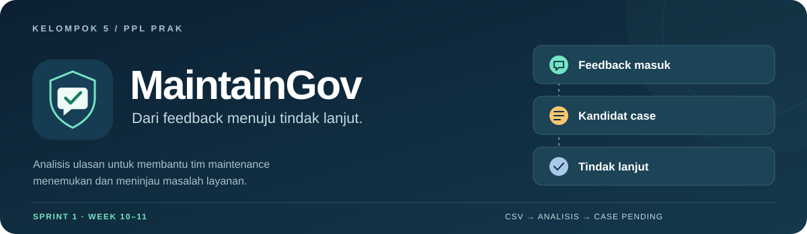
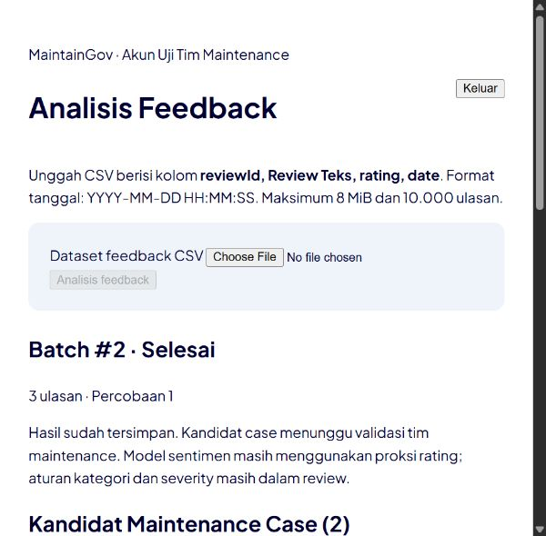
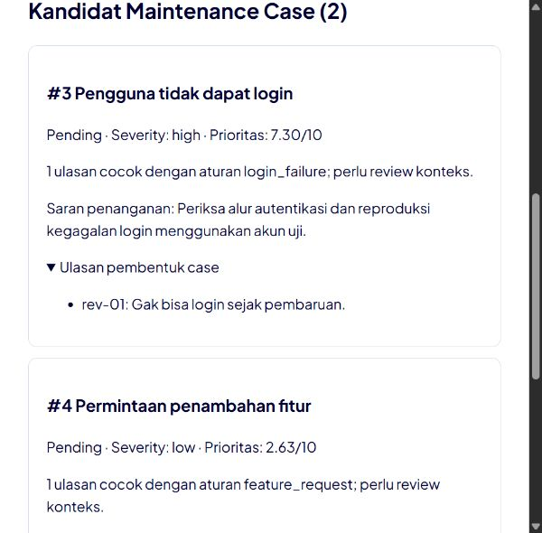
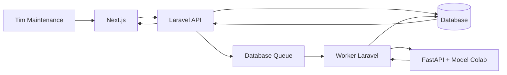

<div align="center">
  
  <p><strong>Feedback pengguna menjadi bahan kerja tim maintenance.</strong></p>
  <p>Unggah ulasan, lihat hasil analisis, dan telusuri kandidat masalah sampai ke sumbernya.</p>
  <p>
    <a href="docs/SETUP_UC01.md"><strong>Mulai menjalankan</strong></a> ·
    <a href="docs/UC01_INTEGRATION.md">Bukti integrasi</a> ·
    <a href="docs/MASTERPLAN.md">Rencana kelompok</a> ·
    <a href="docs/PROGRESS_TRACKER.md">Progres sprint</a>
  </p>
</div>

---

## Tentang MaintainGov

MaintainGov membantu tim maintenance mengolah feedback pengguna menjadi kandidat **Maintenance Case**. Case yang diterima nantinya diteruskan menjadi backlog, pekerjaan Developer, dan pull request di GitHub.

Fokus **Sprint 1 / Week 10–11** adalah alur **login → upload CSV → analisis → case Pending tersimpan dan tampil**. Validasi case, pengerjaan backlog dan integrasi GitHub produk mengikuti sprint berikutnya. GitHub pada tahap ini juga menjadi tempat kelompok mengelola source, issue dan review perubahan.

| Sudah diuji lokal | Hasil |
| :--- | :--- |
| Backend Laravel | **31 tes lulus** pada MariaDB melalui driver mysql |
| Layanan analisis | **7 tes lulus** dengan model Colab asli |
| Frontend Next.js | Typecheck dan production build berhasil |
| Alur browser | Login, upload, hasil tersimpan, refresh dan ulasan pembentuk case |
| Pemulihan proses | Layanan mati → Gagal → retry → Selesai, tanpa output parsial |

<sub>Catatan pemeriksaan: 19 Oktober 2026. Ini hasil uji lokal, bukan badge CI atau persetujuan penerimaan fitur. Rincian dan batas pengujian tersedia pada <a href="docs/evidence/uc01-integration/validation.json">evidence integrasi</a>.</sub>

## Lihat aplikasinya

<table>
  <tr>
    <th align="left">Status batch dan hasil tersimpan</th>
    <th align="left">Case dan ulasan asal</th>
  </tr>
  <tr>
    <td width="50%"></td>
    <td width="50%"></td>
  </tr>
</table>

Tangkapan layar memakai **fixture tersamar: 3 ulasan dan 2 kandidat case**. Case masih Pending dan perlu ditinjau tim Maintenance. Gambar tersebut merupakan tampilan aplikasi lokal, bukan mockup.

## Alur kerja

1. **Masuk sesuai role.** Laravel memeriksa sesi, CSRF dan hak akses.
2. **Unggah CSV.** Struktur kolom, rating, tanggal dan ID ulasan diperiksa sebelum diproses.
3. **Jalankan analisis.** Worker Laravel mengirim teks ke FastAPI untuk inference sentimen serta aturan kategori, severity, grouping dan prioritas.
4. **Tinjau kandidat case.** Hasil disimpan dalam transaksi, lalu tampil bersama ulasan asal. Hasil tetap tersedia setelah refresh.
5. **Tangani kegagalan.** Batch gagal dapat dicoba ulang; pengiriman dengan request key yang sama tidak membuat batch ganda.



Browser mengakses Laravel. Model dan layanan analisis berada di sisi internal. Penjelasan kontrak dan skala prioritas ada di [catatan integrasi](docs/UC01_INTEGRATION.md).

## Jalankan di laptop

Siapkan **PHP ≥8.3, Composer 2, Node ≥20, Python 3.13**, serta database MySQL/MariaDB. Runtime terpisah bisa dipakai tanpa mengganti versi global laptop.

```bash
git clone https://github.com/AgilePemdigi-2026/MaintainGov.git
cd MaintainGov
```

Lanjutkan [panduan setup UC01](docs/SETUP_UC01.md) untuk menyiapkan database, environment, artefak privat, worker dan frontend. Setelah semuanya aktif:

| Komponen | Alamat lokal default |
| :--- | :--- |
| Aplikasi | `http://127.0.0.1:3000/login` |
| Laravel API | `http://127.0.0.1:8000/api/v1` |
| Dokumentasi FastAPI internal | `http://127.0.0.1:8001/internal/docs` |

**Clone saja belum menyediakan model.** Tiga artefak privat hasil Colab perlu disiapkan sesuai panduan. Jika port analisis diubah, samakan `ANALYSIS_SERVICE_URL` dan restart worker. Gunakan host `127.0.0.1` secara konsisten pada demo lokal.

CSV wajib menggunakan UTF-8 dengan kolom `reviewId`, `Review Teks`, `rating`, `date`. Format tanggal: `YYYY-MM-DD HH:MM:SS`. Batas aplikasi: **8 MiB / 10.000 ulasan**. Gunakan [CSV contoh](services/analysis/examples/reviews.csv) untuk percobaan pertama.

## Peta repository

```text
MaintainGov/
├── apps/
│   ├── web/               Next.js · halaman dan alur pengguna
│   └── api/               Laravel · auth, queue dan persistensi
├── services/analysis/     FastAPI · layanan analisis utama
├── notebooks/             Eksperimen dan notebook Google Colab
├── scripts/               Pemeriksaan notebook dan smoke HTTP
├── docs/                  Rencana, arsitektur dan evidence
└── experiments/uc01-api/  Snapshot prototipe penelitian awal
```

Layanan yang dipakai integrasi adalah **`services/analysis`**. Folder `experiments/uc01-api` dipertahankan sebagai referensi; hindari menjalankan prototipe lama ketika mengikuti panduan aplikasi terintegrasi.

## Notebook dan dataset

- [Notebook Colab end-to-end](notebooks/MaintainGov_UC01_End_to_End_Colab.ipynb): input ZIP, EDA, preprocessing, feature engineering/selection, training, tuning, evaluasi dan ekspor.
- [Hasil run kelompok](notebooks/runs/MaintainGov_UC01_run.ipynb): notebook beserta output eksperimen yang sudah dijalankan.
- [Evidence agregat](docs/evidence/uc01-colab-run/): grafik, perbandingan model, metrik dan pemeriksaan validasi.
- [Catatan dataset](docs/DATASET_READINESS.md): profil 7.149 ulasan Tangerang Live dan resource pendukung.

**Batas interpretasi:** model sentimen dilatih menggunakan proksi rating, belum label sentimen manusia. Aturan kategori, severity, grouping dan rekomendasi masih perlu review domain. Kandidat case tidak otomatis menjadi masalah yang valid atau backlog yang diterima.

Dataset mentah, artefak model, hasil privat dan `.env` **tidak masuk Git**. Repository menyimpan source, fixture tersamar dan evidence agregat. Pengujian integrasi lokal memakai MariaDB 10.4.32; verifikasi Oracle MySQL 8, uji beban, evaluasi label manusia dan penerimaan PO belum ditutup.

## Rencana sprint

| Sprint | Minggu | Fokus | Poin baseline |
| :--- | :--- | :--- | ---: |
| **1** | 10–11 | Login/hak akses, logout, analisis feedback UC01 | 10 |
| **2** | 12–13 | Validasi case, edit backlog, pengerjaan issue, koneksi repository dan pengajuan PR | 17 |
| **3** | 14–15 | Review PR, status dan riwayat | 7 |

Total baseline **34 poin**. Poin Done mengikuti bukti dan penerimaan fitur; commit atau hasil demo saja belum menutup seluruh kriteria. Lihat [Master Plan](docs/MASTERPLAN.md) dan [tracker](docs/PROGRESS_TRACKER.md) untuk keputusan kelompok.

## Kelompok 5

| Anggota | Fokus dan kepemilikan |
| :--- | :--- |
| **Gerard Viriyandra** | Project Manager & Lead Feedback Analysis · UC01 |
| **Demas Axel Marfiansyah** | Backend & Database · auth, UC02 dan UC06 |
| **Muhammad Hanif** | Integrasi Backend & GitHub · UC04, UC05 dan koneksi repository |
| **Valisha Vine Ravelina** | Frontend & UI/UX · UC03 serta status/riwayat |

Bantuan lintas anggota diperbolehkan. Pembagian ini menunjukkan tanggung jawab fitur; kontribusi aktual ditelusuri melalui issue, commit, PR dan hasil review.

## Dokumen kerja

| Dokumen | Isi |
| :--- | :--- |
| [Setup UC01](docs/SETUP_UC01.md) | Menjalankan alur aplikasi terintegrasi |
| [Integrasi dan pengujian](docs/UC01_INTEGRATION.md) | Kontrak, persistensi, kegagalan dan bukti lokal |
| [Master Plan](docs/MASTERPLAN.md) | Acuan keputusan dan pembagian tanggung jawab |
| [Arsitektur](docs/ARCHITECTURE.md) | Komponen, rancangan API dan perubahan data |
| [Tugas Week 10](docs/WEEK10_EXECUTION.md) | Urutan pekerjaan dan dependensi |
| [Progress Tracker](docs/PROGRESS_TRACKER.md) | Status, risiko, burndown dan penerimaan |
| [GitHub Workflow](docs/GITHUB_WORKFLOW.md) | Issue, branch, commit dan review |
| [Referensi proyek](docs/references/) | SRS, sprint planning dan panduan monitoring |

Untuk berkontribusi: ambil satu tugas yang jelas, gunakan branch per tugas, buat commit berdasarkan perubahan yang bermakna, dan lampirkan hasil pemeriksaan pada PR. Template tersedia di [.github](.github/).

---

<p align="center"><br /><sub>MaintainGov · Kelompok 5 · PPL Prak</sub></p>
