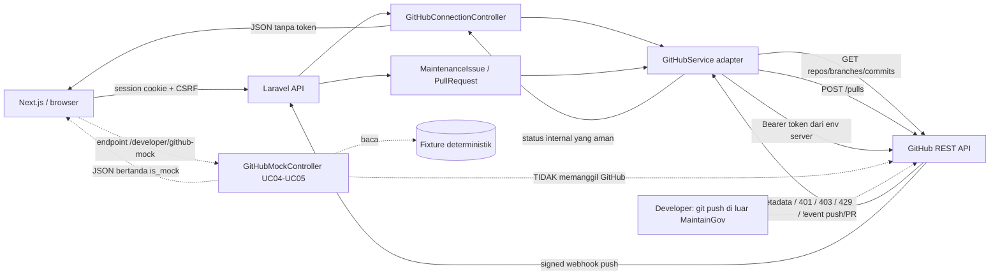

# Integrasi GitHub — Feature 9

Status: koneksi read-only dan backend UC04–UC05 (klaim atomik, verifikasi push, webhook, pembuatan PR nyata, idempotensi, rekonsiliasi) sudah diimplementasikan serta diuji dengan GitHub palsu. **Live authenticated check dan live write smoke masih BLOCKED** karena `GITHUB_TOKEN` belum tersedia di environment lokal. Dokumen ini menjelaskan implementasi aktual, batas operasi tulis, kontrak UC04–UC05, dan langkah verifikasi. Ringkasan status terbaru ada di bagian 0; bagian 1–8 dipertahankan sebagai catatan Week 1 dan telah diberi koreksi status.

Acuan resmi:

- SRS §4.6 UC04 “Mengerjakan Maintenance Issue” (FR-UC04-01..11; BR-13..15).
- SRS §4.7 UC05 “Mengajukan Pull Request” (FR-UC05-01..14; BR-16..18).
- [Arsitektur](ARCHITECTURE.md) §4, §5, §8 dan [Delta PDM Sprint 1](artifacts/shared/pdm-delta-sprint1.md).
- Kontrak endpoint dan fixture Week 1: [contracts/uc04-uc05-api.md](../contracts/uc04-uc05-api.md).
- Kontrak endpoint nyata: [contracts/uc04-uc05-real-api.md](../contracts/uc04-uc05-real-api.md).
- Dokumentasi implementasi, bukti uji, traceability, dan handoff: [UC04_UC05_BACKEND.md](UC04_UC05_BACKEND.md).

## 0. Pembaruan implementasi — 4 November 2026

Bagian 1–8 di bawah adalah catatan Week 1 dan tetap dipertahankan sebagai riwayat. Status aktual setelah W13-01:

| Area | Status aktual | Bukti |
| --- | --- | --- |
| Klaim issue UC04 | Nyata, atomik, persisten | `/maintenance-backlogs/{issue}/claim` |
| Verifikasi push manual | Nyata, membaca branch/commit GitHub | `/maintenance-backlogs/{issue}/push-verifications` |
| Webhook push | Nyata, HMAC + ledger delivery + validasi aktor | `POST /webhooks/github` |
| Buat Pull Request | Nyata, `POST /repos/{owner}/{repo}/pulls` | `/maintenance-backlogs/{issue}/pull-requests` |
| Metadata PR | Persisten di tabel `pull_request` | Migration `2026_11_04_000004` |
| Idempotensi | Fingerprint + `Idempotency-Key` + unique head tuple | `PullRequestService` |
| Rekonsiliasi | Endpoint + `github:reconcile-pull-requests` | Tanpa membuat PR baru |
| Live authenticated check | **BLOCKED** — `GITHUB_TOKEN` belum tersedia | `github:check`, `github:smoke-uc05` |
| Mock Week 1 | Tetap aktif hanya di local/testing | `/developer/github-mock/*` |

Perubahan skema: `github_repository`, `pull_request`, `github_webhook_delivery`; kolom `maintenance_backlog.repository_id`, `last_push_sha`, `last_push_at`; `source_branch` diperlebar ke 255; `pengguna_sistem.github_login` nullable unique. Token tetap **hanya** di environment, tidak disimpan di database.

Hasil verifikasi terakhir: 231 test (230 lulus, 1 skipped pre-existing, 1.143 assertions); 82 test UC04/UC05 baru semuanya lulus. Tidak ada PR nyata yang dibuat dalam pengujian otomatis. Live write test belum boleh diklaim PASS. Detail lengkap ada di [UC04_UC05_BACKEND.md](UC04_UC05_BACKEND.md).

## 1. Alur koneksi



Frontend tidak pernah menerima token GitHub. Token hanya dibaca oleh Laravel dari environment server. Garis putus-putus menunjukkan mock Week 1 yang tetap aktif hanya di local/testing. Operasi tulis **ke GitHub** hanya terjadi pada alur UC05 setelah seluruh validasi lulus; webhook push hanya membaca branch/commit GitHub lalu menulis status ke database. Tidak ada endpoint untuk melakukan `git push` karena perubahan source code tetap dilakukan di luar MaintainGov.

## 2. Konfigurasi

Tambahkan variabel berikut pada `apps/api/.env` lokal atau secret manager. Jangan commit nilai token.

| Variabel | Default | Keterangan |
| --- | --- | --- |
| `GITHUB_API_URL` | `https://api.github.com` | Base URL GitHub REST API. |
| `GITHUB_REPOSITORY_OWNER` | `AgilePemdigi-2026` | Owner repository utama. |
| `GITHUB_REPOSITORY_NAME` | `MaintainGov` | Nama repository utama. |
| `GITHUB_DEFAULT_BRANCH` | `main` | Branch tujuan default dan branch yang dilindungi dari klaim. |
| `GITHUB_TOKEN` | kosong | Token server-side untuk baca metadata/branch/commit dan tulis Pull Request. Wajib untuk operasi nyata. |
| `GITHUB_TIMEOUT` | `10` | Timeout request (detik). |
| `GITHUB_CONNECT_TIMEOUT` | `5` | Timeout koneksi (detik). |
| `GITHUB_WEBHOOK_SECRET` | kosong | HMAC secret `X-Hub-Signature-256`; kosong berarti webhook ditolak 503. |
| `GITHUB_WEBHOOK_MAX_AGE` | `900` | Umur maksimum delivery push (detik); `0` menonaktifkan cek. |
| `GITHUB_PR_STALE_SECONDS` | `60` | Umur minimum baris PR `pending` sebelum aman direkonsiliasi/di-retry. |
| `GITHUB_MOCK_ENABLED` | aktif saat `local`/`testing` | Mengaktifkan route mock UC04–UC05. Route mengembalikan 404 saat nonaktif. |

Implementasi saat ini memakai **Bearer token** (`GITHUB_TOKEN`). Ini dapat berupa fine-grained personal access token, atau mekanisme token lain yang disetujui tim. **GitHub App JWT/installation-token exchange belum diimplementasikan** karena kredensial App dan izinnya belum diverifikasi (D09). Jangan menganggap App sudah aktif.

Izin minimum yang dibutuhkan implementasi UC04/UC05 adalah **Metadata: read**, **Contents: read**, dan **Pull requests: write** pada repository target. Izin aktual belum dinyatakan terverifikasi karena live check masih BLOCKED. Token tidak boleh dikirim ke browser atau disimpan di database.

Jika token belum tersedia, adapter tidak mengirim request dan mengembalikan status aman `unavailable` dengan kode `GITHUB_NOT_CONFIGURED`.

## 3. Endpoint pemeriksaan koneksi

`GET /api/v1/github/connection`

- Autentikasi: sesi Laravel; role `Tim Maintenance` atau `Developer`.
- Implementasi: **nyata**, read-only `GET /repos/{owner}/{repo}`.
- Tidak ada parameter.
- Respons sukses: HTTP 200, status internal `connected`.
- Respons gagal memakai `success=false`, `message`, `error.code`, `error.message`, dan `data.status`.

| Status internal | Kondisi | HTTP | Kode error |
| --- | --- | --- | --- |
| `connected` | Repository berhasil dibaca | 200 | — |
| `unauthorized` | GitHub merespons 401 | 401 | `GITHUB_UNAUTHORIZED` |
| `forbidden` | GitHub merespons 403 dan bukan rate limit | 403 | `GITHUB_FORBIDDEN` |
| `rate_limited` | 429, atau 403 dengan header/body rate limit | 429 | `GITHUB_RATE_LIMITED` |
| `not_found` | 404 (repository tidak ada atau tidak dapat diakses) | 404 | `GITHUB_REPOSITORY_NOT_FOUND` |
| `unavailable` | Timeout, jaringan, 5xx, respons tidak valid, atau konfigurasi belum lengkap | 503 | `GITHUB_UNAVAILABLE`, `GITHUB_INVALID_RESPONSE`, `GITHUB_NOT_CONFIGURED`, `GITHUB_UNEXPECTED_STATUS` |

Rate limit tidak disimpulkan dari semua respons 403. Adapter memeriksa `X-RateLimit-Remaining: 0`, `Retry-After`, pesan “rate limit”/“secondary rate limit”, dan `documentation_url` yang relevan. Untuk rate limit, `error.retry_after_seconds` dan header `Retry-After` diisi bila GitHub menyediakannya.

Contoh sukses ada di [`contracts/fixtures/uc04-uc05/connection-success.json`](../contracts/fixtures/uc04-uc05/connection-success.json). Contoh error tersedia untuk unauthorized, forbidden, rate-limited, unavailable, not-found, dan not-configured pada folder fixture yang sama.

## 4. Pengujian live (read-only default)

Perintah manual:

```bash
cd apps/api
php artisan github:check
```

Perilaku:

- Token tersedia dan repository terbaca: mencetak `PASS`, metadata repository, dan permission yang benar-benar dikembalikan GitHub. Exit code `0`.
- Token belum tersedia: mencetak `BLOCKED` tanpa request jaringan. Exit code `1`.
- Gagal autentikasi/otorisasi/rate limit/jaringan: mencetak status aman tanpa token. Exit code `1`.

Token tidak pernah dicetak. Jangan memakai unit test mock sebagai bukti koneksi live.

Pemeriksaan live UC05 tanpa efek samping:

```bash
cd apps/api
php artisan github:smoke-uc05 --issue={backlog_id} --branch={source_branch}
```

Perintah ini hanya membaca koneksi, branch, commit, dan PR yang sudah ada. Opsi `--require-write` membuat perintah gagal bila respons repository tidak melaporkan permission `push`; ini hanya memeriksa permission yang dilaporkan GitHub, bukan bukti PR berhasil dibuat. Perintah ini tidak pernah membuat PR. Rekonsiliasi operasional memakai `php artisan github:reconcile-pull-requests` (`--dry-run` tidak memanggil GitHub). Status live tetap **BLOCKED** sampai token dan izin tersedia.

**Hasil pemeriksaan 1 November 2026:**

- `php artisan github:check` → **BLOCKED**: `GITHUB_TOKEN` belum dikonfigurasi; tidak ada request jaringan.
- Pemeriksaan publik tambahan tanpa autentikasi ke `https://api.github.com/repos/AgilePemdigi-2026/MaintainGov` → HTTP 200, `full_name=AgilePemdigi-2026/MaintainGov`, `default_branch=main`, `private=false`, waktu `2026-11-01T12:33:20Z`.
- Pemeriksaan publik ini hanya membuktikan repository dapat dibaca tanpa token. **Status autentikasi dan permissions tetap BLOCKED.**
- Tidak ada operasi tulis, commit, branch, atau PR yang dilakukan.

## 5. Kontrak UC04–UC05: endpoint nyata dan mock Week 1

Kontrak endpoint nyata: [contracts/uc04-uc05-real-api.md](../contracts/uc04-uc05-real-api.md). Route produksi berada di `/api/v1/developer/maintenance-issues`, `/api/v1/maintenance-backlogs/{issue}/claim`, `/api/v1/maintenance-backlogs/{issue}/push-status`, `/api/v1/maintenance-backlogs/{issue}/push-verifications`, `/api/v1/maintenance-backlogs/{issue}/branches`, `/api/v1/maintenance-backlogs/{issue}/pull-requests`, `/api/v1/maintenance-backlogs/{issue}/pull-requests/reconcile`, `/api/v1/pull-requests/{pullRequest}`, dan `/api/v1/webhooks/github`. Detail alur, idempotensi, rekonsiliasi, dan error ada di [UC04_UC05_BACKEND.md](UC04_UC05_BACKEND.md).

Kontrak mock Week 1 tetap dipertahankan dan tidak diubah: [contracts/uc04-uc05-api.md](../contracts/uc04-uc05-api.md). Ringkasan route mock:

| Method/path | Kegunaan | Tipe |
| --- | --- | --- |
| `GET /developer/github-mock/issues` | Daftar issue/backlog dan filter status | mock |
| `GET /developer/github-mock/issues/{id}` | Detail issue, repository, branch sumber, push | mock |
| `POST /developer/github-mock/issues/{id}/claim` | Klaim issue oleh Developer | mock |
| `GET /developer/github-mock/issues/{id}/push-status` | Status push yang diterima dari GitHub | mock read-only |
| `GET /developer/github-mock/issues/{id}/branches` | Branch sumber/tujuan | mock |
| `GET /developer/github-mock/issues/{id}/pull-requests` | Status PR (termasuk empty state) | mock |
| `POST /developer/github-mock/issues/{id}/pull-requests` | Persiapan pembuatan PR | stub, **tidak membuat PR nyata** |

Semua respons mock memiliki header `X-Mock-Data: true` dan `meta.is_mock=true`. Tidak ada penyimpanan database dan tidak ada panggilan GitHub. `github_pr_number` dan `github_pr_url` sengaja `null` pada stub agar UI tidak menampilkan tautan PR palsu. Mock dijalankan hanya jika `GITHUB_MOCK_ENABLED` aktif; default nonaktif di production.

Stub PR tidak menggantikan pemeriksaan koneksi. Frontend tetap wajib memanggil `GET /github/connection` sebelum menampilkan formulir (FR-UC05-03). Jika gagal, tampilkan persis “Koneksi GitHub tidak tersedia, pengajuan belum diproses” dan jangan mengubah status issue (FR-UC05-04). Karena endpoint koneksi bersifat nyata, alur sukses end-to-end tetap membutuhkan `GITHUB_TOKEN`; mock hanya membantu membangun state UI.

Operasi push tidak dibuat sebagai endpoint tulis karena SRS §4.6.1 menyatakan perubahan source code dilakukan di luar MaintainGov. `push-status` hanya membaca status. Integrasi webhook push dan pembuatan PR nyata **sudah diimplementasikan di route produksi** (bukan di mock); lihat bagian 0 dan kontrak nyata. Mock tetap tidak memanggil GitHub dan tidak menyimpan data.

## 6. Batas implementasi dan keputusan terbuka

Status per 4 November 2026:

- Live authenticated check dan live write smoke membutuhkan `GITHUB_TOKEN` yang sah; token belum tersedia sehingga statusnya **BLOCKED**, bukan PASS.
- GitHub App belum diverifikasi; mekanisme token saat ini adalah Bearer token dan tidak boleh diklaim sebagai GitHub App.
- Namespace mock `/developer/github-mock` tetap dipertahankan untuk demo tanpa kredensial. Path produksi `/maintenance-backlogs/...`, `/developer/maintenance-issues`, `/pull-requests/...`, dan `/webhooks/github` sudah diimplementasikan tanpa mengubah kontrak mock.
- Tabel `github_repository`, `pull_request`, dan `github_webhook_delivery` sudah dibuat; `maintenance_backlog` mendapat `repository_id`, `last_push_sha`, `last_push_at`; `pengguna_sistem.github_login` ditambahkan. Detail final ada di [GITHUB_DATABASE_HANDOFF.md](GITHUB_DATABASE_HANDOFF.md).
- Signature webhook, deduplikasi delivery ID, replay/staleness, verifikasi push manual/webhook, pembuatan PR nyata, idempotensi, dan rekonsiliasi **sudah diimplementasikan dan diuji dengan GitHub palsu**. Bukti live tetap BLOCKED.
- Status `Ready for Merge`, `Closed`, dan `Merged`, serta pemetaan reviewer dan review/approve/merge UC06, belum diimplementasikan dan tetap di luar scope.
- UI frontend belum diimplementasikan/diverifikasi terhadap endpoint nyata; handoff ada di [UC04_UC05_BACKEND.md](UC04_UC05_BACKEND.md) §11.

## 7. Pengujian otomatis

```bash
cd apps/api
php artisan test --compact tests/Unit/GitHubServiceTest.php
php artisan test --compact tests/Feature/GitHubConnectionTest.php
php artisan test --compact tests/Feature/GitHubMockContractTest.php
php artisan test --compact tests/Feature/MaintenanceIssueClaimTest.php tests/Feature/PushVerificationTest.php tests/Feature/GitHubWebhookTest.php tests/Feature/PullRequestCreationTest.php tests/Feature/Uc04Uc05FlowTest.php tests/Feature/GitHubUc04Uc05CommandsTest.php
```

Seluruh unit test adapter memakai `Http::fake`/`Http::preventStrayRequests`, sehingga tidak membutuhkan internet atau token. Feature test memakai sesi Laravel dan mock HTTP yang sama.

Hasil 4 November 2026: full suite **231 test, 230 lulus, 1 skipped pre-existing, 1.143 assertions**; 82 test UC04/UC05 baru semuanya lulus (429 assertions). Rincian per file ada di [UC04_UC05_BACKEND.md](UC04_UC05_BACKEND.md) §9.

## 8. Langkah QA untuk Gerard

Tujuan: memeriksa kontrak dan perilaku UI tanpa kredensial GitHub. Langkah ini **bukan** bukti koneksi live dan tidak boleh dilaporkan sebagai integrasi GitHub nyata.

Prasyarat:

- `APP_ENV=local` (atau `testing`) dan `GITHUB_MOCK_ENABLED=true` di `.env` lokal. Jangan aktifkan mock di production.
- Tersedia akun `Developer` dan `Tim Maintenance`.
- Frontend mengirim session cookie dan header `X-CSRF-TOKEN` untuk request `POST`.

Langkah:

1. Tanpa sesi, buka `GET /api/v1/github/connection` dan salah satu route mock. Pastikan hasilnya HTTP 401 dan tidak ada data repository.
2. Login sebagai `Developer`, lalu buka `GET /api/v1/github/connection`. Tanpa `GITHUB_TOKEN`, pastikan HTTP 503, `data.status=unavailable`, `error.code=GITHUB_NOT_CONFIGURED`, dan tidak ada token di body maupun DevTools. Jika dipicu dari alur Ajukan PR, UI harus menampilkan “Koneksi GitHub tidak tersedia, pengajuan belum diproses” dan status issue tidak berubah (FR-UC05-04).
3. Buka `GET /api/v1/developer/github-mock/issues`. Pastikan HTTP 200, header `X-Mock-Data: true`, `meta.is_mock=true`, tiga issue, dan tidak ada request ke `api.github.com`.
4. Uji filter `?status=Ready%20for%20Merge`; pastikan `data=[]` dan `meta.total=0`, bukan error.
5. `POST /issues/101/claim`; pastikan HTTP 200, status berubah menjadi `Sedang Dikerjakan` pada respons, ada pesan bahwa data tidak benar-benar diubah, dan refresh daftar tetap menunjukkan kondisi mock awal.
6. `POST /issues/103/claim`; pastikan HTTP 409 `ISSUE_ALREADY_ASSIGNED` dengan pesan SRS.
7. Buka `GET /issues/102/branches` dan `GET /issues/102/pull-requests`; pastikan data berlabel mock dan `github_pr_number`/`github_pr_url` bernilai `null`.
8. `POST /issues/102/pull-requests` dengan body valid; pastikan HTTP 201, pesan “tidak dibuat di GitHub”, dan tidak ada tautan PR palsu di UI. UI harus menampilkan penanda mock, bukan notifikasi “Pull Request berhasil dibuat” seolah PR nyata; notifikasi sukses SRS hanya boleh muncul setelah integrasi GitHub nyata berhasil.
9. Login sebagai `Tim Maintenance`; pastikan route mock menghasilkan HTTP 403. Route koneksi harus tetap dapat diakses kedua role.
10. Set `GITHUB_MOCK_ENABLED=false`, bersihkan config cache, lalu ulangi route mock; pastikan HTTP 404.
11. Periksa Network tab: tidak boleh ada request langsung dari browser ke GitHub dan tidak boleh ada nilai token pada request/response.
12. Setelah `GITHUB_TOKEN` tersedia, jalankan `php artisan github:check`. Baru setelah itu status autentikasi dan permission boleh dicatat sebagai terverifikasi.
13. Untuk pengujian alur nyata (klaim → verifikasi push → PR → rekonsiliasi), gunakan checklist di [UC04_UC05_BACKEND.md](UC04_UC05_BACKEND.md) §11.2. Langkah mock di atas tidak boleh dipakai sebagai bukti PR nyata.

Bukti yang perlu dicatat: tanggal/waktu, role yang dipakai, HTTP status, `error.code`, header `X-Mock-Data`, dan ada/tidaknya request ke GitHub. Jangan memakai screenshot mock sebagai bukti PR atau push nyata.
