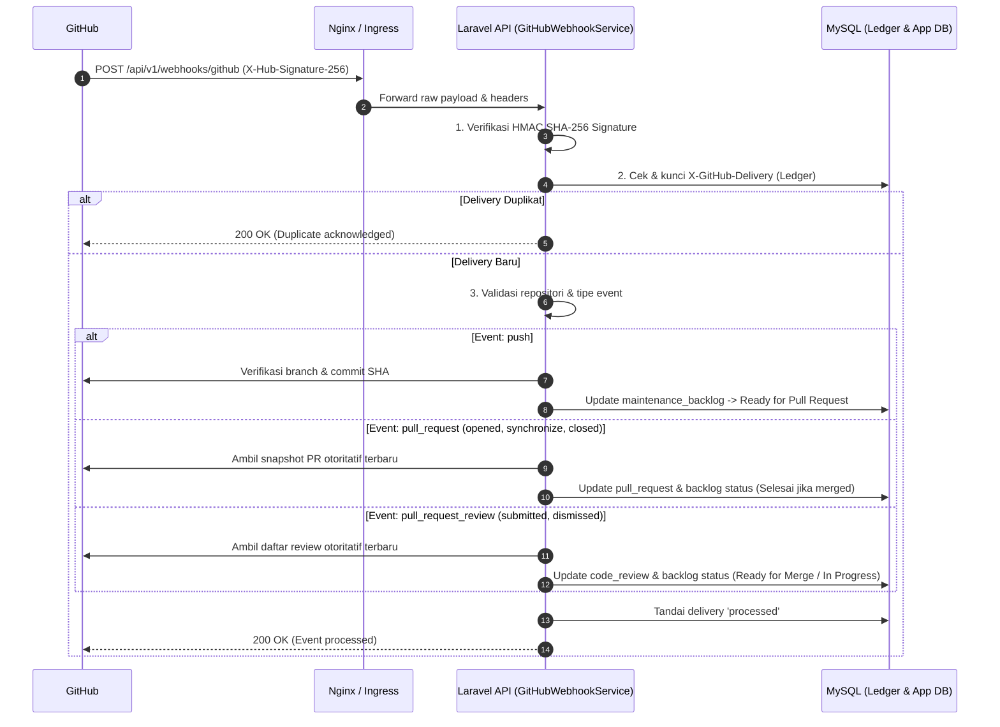

# KONFIGURASI WEBHOOK GITHUB (MAINTAINGOVSMART INTEGRATION)

**Dokumen:** Konfigurasi Webhook Otoritatif  
**Sprint:** Sprint 3 – Week 14  
**PIC:** Muhammad Hanif (`@Haniippp`)  
**Target Repositori:** `AgilePemdigi-2026/MaintainGov`  

---

## 1. Ikhtisar Arsitektur Webhook

MaintainGov mengimplementasikan sinkronisasi dua arah dengan GitHub. Selain sinkronisasi aktif melalui polling/sync endpoint, sistem menerima event webhook dari GitHub untuk memperbarui status aplikasi secara *real-time*:



---

## 2. Event yang Didukung dan Logika Transisi Status

| Event GitHub | Action | Efek pada MaintainGov | Logika Pemrosesan |
|---|---|---|---|
| `ping` | - | None (Koneksi webhook terverifikasi) | Mengembalikan `200 OK status: pong`. |
| `push` | - | Mengubah issue dari `Sedang Dikerjakan` menjadi `Ready for Pull Request`. | Memverifikasi apakah branch diawali `refs/heads/`, memeriksa umur timestamp (`GITHUB_WEBHOOK_MAX_AGE`), membaca commit dari GitHub API, dan mencatat `last_push_sha`. |
| `pull_request` | `opened`<br>`synchronize`<br>`reopened` | Memperbarui snapshot PR lokal. | Mengambil data terbaru dari GitHub untuk mencegah status mundur (*out-of-order*). |
| `pull_request` | `closed` *(Merged)* | Mengubah issue menjadi **`Selesai` (`STATUS_DONE`)**. | Memeriksa `merged === true` atau `merged_at !== null`. |
| `pull_request` | `closed` *(Unmerged)* | Menjaga issue tetap **`Ready for Pull Request`** (TIDAK menjadi Selesai). | Memastikan PR ditutup tanpa merge tidak menandai pekerjaan selesai. |
| `pull_request_review` | `submitted`<br>`dismissed`<br>`edited` | Memperbarui tabel `code_review` dan status issue: <br>• Jika approved -> **`Ready for Merge`** <br>• Jika changes requested -> **`Sedang Dikerjakan`**. | Membaca daftar seluruh review di GitHub untuk menghitung konsensus review terbaru per reviewer. |

---

## 3. Langkah Konfigurasi di Repositori GitHub

Untuk mendaftarkan webhook pada repositori `AgilePemdigi-2026/MaintainGov`:

1. Buka repositori di GitHub: `https://github.com/AgilePemdigi-2026/MaintainGov/settings/hooks`.
2. Klik tombol **Add webhook**.
3. Masukkan konfigurasi berikut:
   - **Payload URL:**
     - *Development/Local:* `https://<tunnel-subdomain>.ngrok-free.app/api/v1/webhooks/github`
     - *Staging:* `https://staging-api.maintaingov.id/api/v1/webhooks/github`
   - **Content type:** `application/json`
   - **Secret:** Masukkan string acak kuat (minimal 32 karakter), misalnya hasil dari `openssl rand -hex 20`.
   - **SSL verification:** `Enable SSL verification`.
   - **Which events would you like to trigger this webhook?**
     Pilih **Let me select individual events**:
     - [x] **Pushes**
     - [x] **Pull requests**
     - [x] **Pull request reviews**
4. Pastikan **Active** dicentang.
5. Klik **Add webhook**.
6. Salin nilai secret yang sama ke file `.env` server backend:
   ```env
   GITHUB_WEBHOOK_SECRET="nilai_secret_yang_sama_persis"
   GITHUB_WEBHOOK_MAX_AGE=900
   ```

---

## 4. Keamanan dan Idempotensi

1. **HMAC Signature Check:** Header `X-Hub-Signature-256` dihitung ulang menggunakan `hash_hmac('sha256', $rawBody, $secret)` dengan fungsi `hash_equals()`. Jika tidak cocok atau header kosong, request langsung ditolak dengan `401 Unauthorized`.
2. **Ledger Delivery (`github_webhook_delivery`):** Setiap UUID pada header `X-GitHub-Delivery` dicatat dalam database. Pengiriman ulang (*replay*) dari event yang sama tidak akan mengeksekusi logika bisnis dua kali, melainkan langsung mengembalikan `200 OK (duplicate)`.
3. **Out-of-Order Safety:** Payload webhook GitHub hanya diperlakukan sebagai sinyal pemicu (*trigger*). Detail Pull Request dan review selalu dibaca ulang dari GitHub API untuk menjamin urutan data terbaru dan konsisten.
