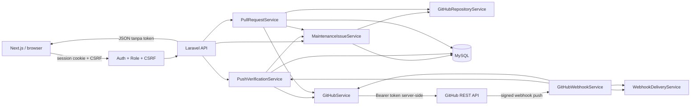
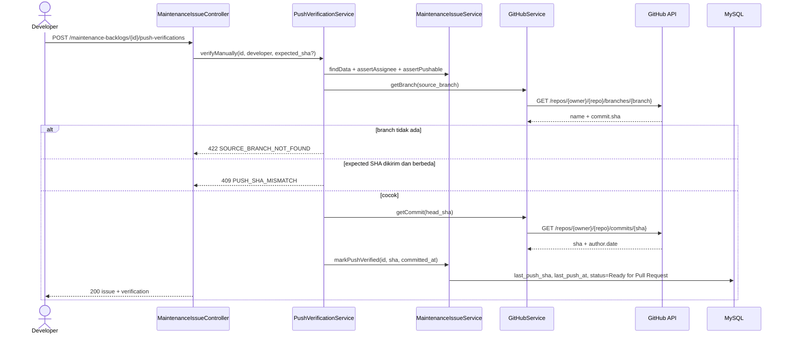
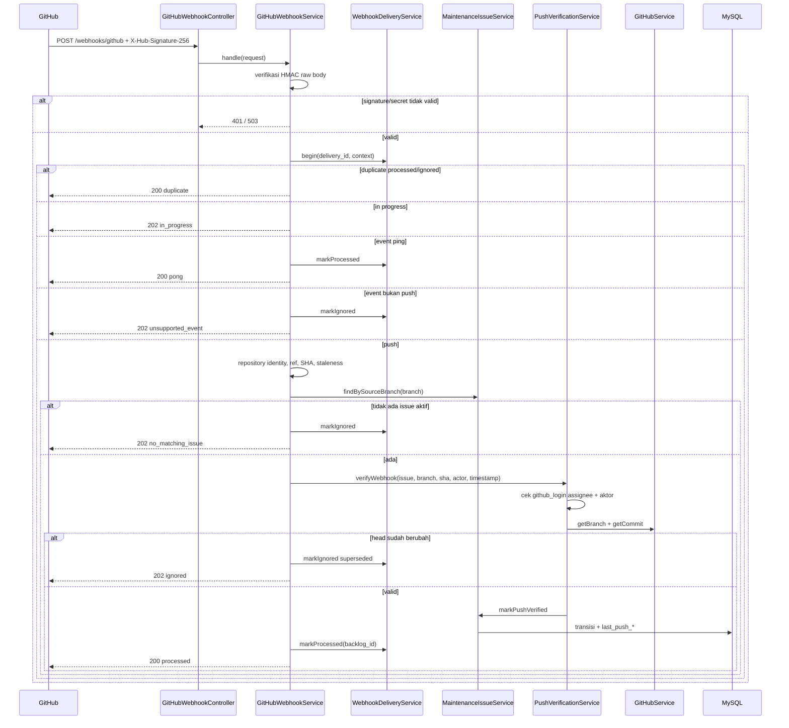
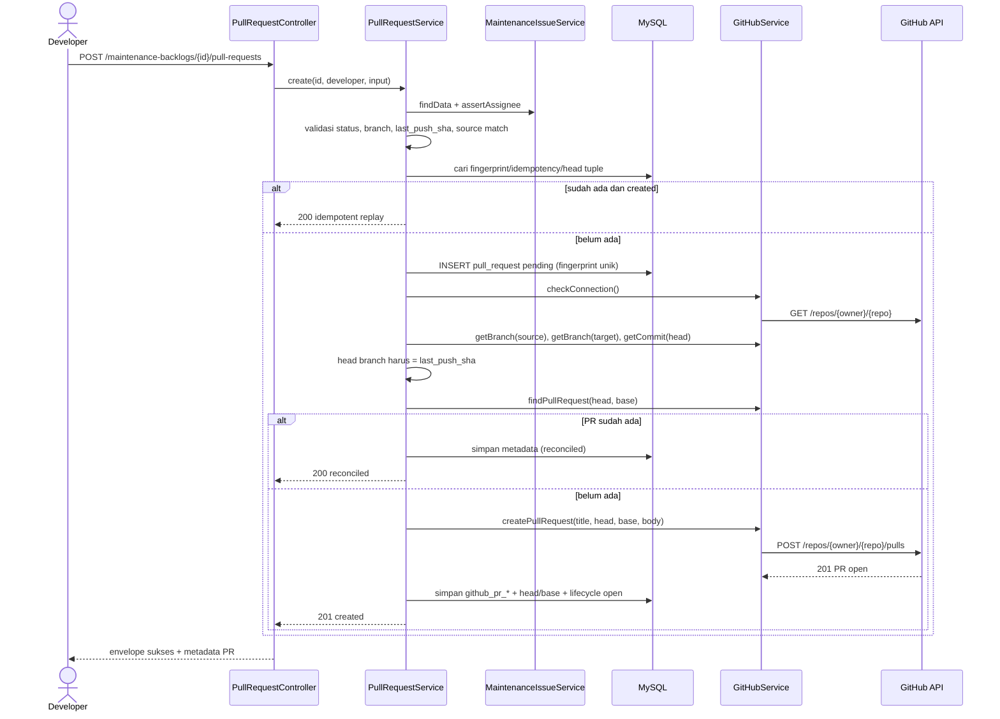
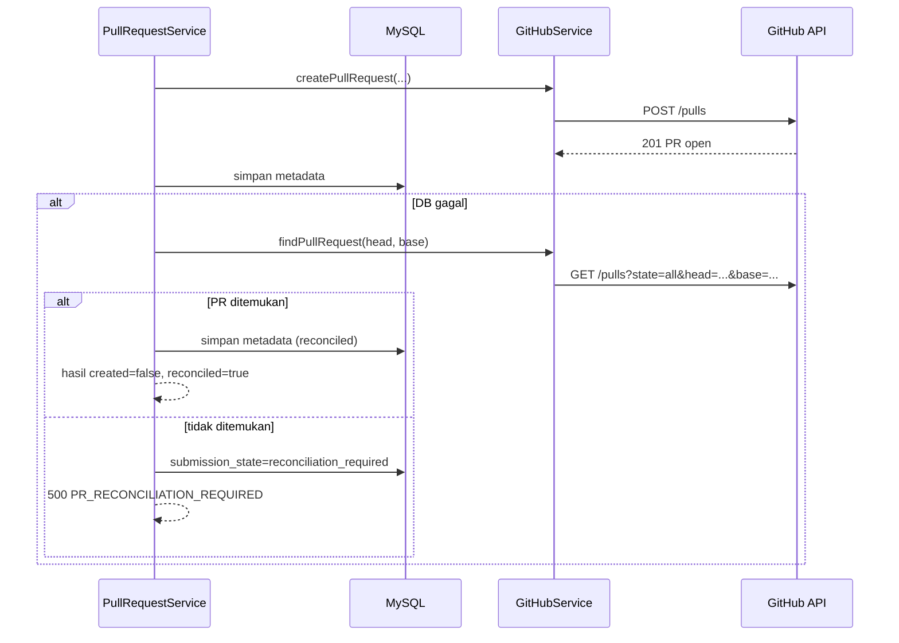

# UC04–UC05 Backend — Implementasi Nyata, Bukti Uji, dan Handoff

Tanggal: 4 November 2026<br>
Branch: `feature/W13-01-uc04-uc05-backend`<br>
Pemilik: Hanif (integrasi GitHub/backend UC04–UC05)<br>
Status: **implementasi backend selesai dan teruji dengan GitHub palsu; live GitHub authenticated smoke BLOCKED karena token belum tersedia**.

Dokumen ini menjelaskan implementasi nyata UC04 (klaim issue dan verifikasi push) dan UC05 (pembuatan Pull Request GitHub + persistensi metadata). Kontrak endpoint ada di [`contracts/uc04-uc05-real-api.md`](../contracts/uc04-uc05-real-api.md). Kontrak mock Week 1 tetap di [`contracts/uc04-uc05-api.md`](../contracts/uc04-uc05-api.md) dan tidak diubah.

## 1. Ringkasan hasil

| Area | Status | Bukti |
| --- | --- | --- |
| Klaim issue atomik | Selesai | `MaintenanceIssueService::claim()`, feature test |
| Push manual dari GitHub API | Selesai | `PushVerificationService::verifyManually()` |
| Webhook push bertanda tangan | Selesai | `GitHubWebhookService`, `GitHubWebhookTest` |
| Pembuatan PR GitHub nyata | Selesai secara kode dan mocked test | `GitHubService::createPullRequest()`, `PullRequestService` |
| Persistensi metadata PR | Selesai | Tabel `pull_request`, feature test |
| Idempotensi/rekonsiliasi | Selesai | fingerprint, unique tuple, reconcile endpoint/command |
| Live GitHub smoke | **BLOCKED** | `GITHUB_TOKEN` belum tersedia |
| Review/approve/merge UC06 | Di luar scope | Tidak diimplementasikan |
| UI/frontend | Handoff | Backend siap; UI belum diverifikasi di dokumen ini |

Tidak ada PR nyata yang dibuat selama pengujian otomatis. Seluruh panggilan GitHub pada test memakai `Http::fake()` dan `Http::preventStrayRequests()`.

## 2. Batas dan keputusan

- Implementasi memakai adapter yang sudah ada, `App\Services\GitHub\GitHubService`, dan memperluasnya. Tidak ada adapter GitHub kedua.
- Route mock `/developer/github-mock/*` dipertahankan agar kontrak Week 1 dan pekerjaan frontend tidak rusak. Route nyata berada di `/maintenance-backlogs/*`, `/developer/maintenance-issues`, `/pull-requests/*`, dan `/webhooks/github`.
- Sumber kebenaran repository adalah konfigurasi server (`owner`, `repository`), bukan input browser.
- Pull Request dianggap berhasil hanya setelah GitHub mengembalikan PR `open` **dan** metadata tersimpan. Baris DB saja bukan bukti sukses.
- `GET` tidak pernah mengubah data. Klaim, verifikasi push, pembuatan PR, dan webhook adalah satu-satunya jalur mutasi UC04/UC05.
- `github_login` pada `pengguna_sistem` bersifat opsional. Tanpa pemetaan, verifikasi manual tetap bekerja, tetapi webhook menolak transisi dengan `WEBHOOK_ASSIGNEE_UNMAPPED`.

## 3. Arsitektur komponen



Komponen utama:

| Komponen | Tanggung jawab |
| --- | --- |
| `MaintenanceIssueService` | List/detail, klaim atomik, status push, transisi status, lookup branch. |
| `PushVerificationService` | Verifikasi manual dan webhook terhadap branch/commit GitHub. |
| `GitHubWebhookService` | Signature, deduplikasi, validasi repository/ref/SHA/umur, aktor, orkestrasi. |
| `WebhookDeliveryService` | Ledger delivery, duplicate/replay/retry. |
| `PullRequestService` | Validasi UC05, idempotensi, pemanggilan PR nyata, persistensi, rekonsiliasi. |
| `GitHubService` | Satu adapter untuk koneksi, branch, commit, cari PR, buat PR baca PR. |
| `GitHubRepositoryService` | Menyimpan/menautkan repository trusted, tanpa menyimpan token. |

## 4. Perubahan skema

Migration baru bersifat aditif dan mempertahankan kolom W12-01 (`assigned_to`, `assigned_at`, `source_branch`).

| Migration | Perubahan | Catatan |
| --- | --- | --- |
| `2026_11_04_000001_create_github_repository_table` | Tabel `github_repository` | Metadata repository; unique `full_name`, unique `github_repository_id` nullable. |
| `2026_11_04_000002_add_uc04_uc05_fields_to_maintenance_backlog` | `repository_id`, `last_push_sha`, `last_push_at`; index; `source_branch` → 255 | FK repository `nullOnDelete`; index assigned/source/repository. |
| `2026_11_04_000003_add_github_login_to_pengguna_sistem` | `github_login` nullable unique | Wajib untuk verifikasi aktor webhook. |
| `2026_11_04_000004_create_pull_request_table` | Tabel `pull_request` | Unique fingerprint, idempotency per backlog, tuple branch/head, PR number/id. |
| `2026_11_04_000005_create_github_webhook_delivery_table` | Tabel `github_webhook_delivery` | Unique delivery ID; status `received/processed/ignored/failed`. |

Relasi:

```text
maintenance_case 1 ── 0..1 maintenance_backlog
github_repository 1 ── 0..* maintenance_backlog
maintenance_backlog 1 ── 0..* pull_request
maintenance_backlog 1 ── 0..* github_webhook_delivery
pengguna_sistem 1 ── 0..* maintenance_backlog (assigned_to)
pengguna_sistem 1 ── 0..* pull_request (developer_id)
pengguna_sistem 0..1 ── github_login (pemetaan webhook)
```

`code_review` tidak dibuat karena UC06 masih di luar scope.

## 5. Alur UC04

### 5.1 Klaim issue (atomik)

```mermaid
sequenceDiagram
    actor D as Developer
    participant API as MaintenanceIssueController
    participant S as MaintenanceIssueService
    participant R as GitHubRepositoryService
    participant DB as MySQL

    D->>API: POST /maintenance-backlogs/{id}/claim
    API->>S: claim(id, developer, source_branch?)
    S->>R: ensureConfigured()
    R->>DB: updateOrCreate github_repository (trusted owner/name)
    S->>S: validasi default branch + format branch
    S->>DB: BEGIN; SELECT backlog FOR UPDATE
    alt tidak ada
        S-->>API: 404 ISSUE_NOT_FOUND
    else sudah assigned
        S-->>API: 409 ISSUE_ALREADY_ASSIGNED
    else status bukan Ready for Development
        S-->>API: 409 ISSUE_NOT_CLAIMABLE
    else branch dipakai issue aktif
        S-->>API: 409 SOURCE_BRANCH_IN_USE
    else valid
        S->>DB: UPDATE ... WHERE assigned_to IS NULL AND status = Ready for Development
        S->>DB: COMMIT
        API-->>D: 200 issue + assigned_to + assigned_at
    end
```

Invariant:

- `assigned_to` dan `assigned_at` diisi; `source_branch` diisi default `maintenance/issue-{id}` bila tidak dikirim.
- Status berubah ke `Sedang Dikerjakan`.
- Jika update bersyarat tidak mengenai tepat satu baris, klaim gagal `ISSUE_ALREADY_ASSIGNED`.
- Klaim tidak memanggil GitHub.

### 5.2 Verifikasi push manual



`GET /push-status` hanya membaca kolom. Tidak ada panggilan GitHub dan tidak ada mutasi.

### 5.3 Webhook push



Keamanan webhook:

- Signature diverifikasi sebelum ledger, database, atau GitHub disentuh.
- Delivery ID unik; ID sama dengan payload berbeda → `409 WEBHOOK_DELIVERY_CONFLICT`.
- Repository harus persis `owner/repository` konfigurasi.
- Hanya `refs/heads/*`; tag dan branch deletion diabaikan.
- Delivery lebih tua dari `GITHUB_WEBHOOK_MAX_AGE` ditolak.
- Aktor push harus sama dengan `pengguna_sistem.github_login` assignee.
- Head branch harus masih sama dengan SHA event; event yang disusul push baru diabaikan.
- Commit diverifikasi lewat GitHub API sebelum transisi.
- Delivery `failed` dapat di-retry dengan ID sama; status sukses tidak diproses ulang.

## 6. Alur UC05

### 6.1 Pembuatan PR nyata dan idempotensi



Validasi sebelum efek samping:

1. Assignee.
2. Status `Ready for Pull Request`.
3. Branch sumber issue ada dan sama dengan body.
4. Push terverifikasi tersedia.
5. Koneksi GitHub.
6. Branch sumber dan tujuan ada.
7. Head branch masih sama dengan `last_push_sha`.
8. Commit ada.
9. Tidak ada PR yang sudah ada untuk head/base.

### 6.2 Rekonsiliasi setelah GitHub sukses / DB gagal



Prinsip:

- Tidak ada klaim sukses jika metadata belum tersimpan.
- Tidak ada PR kedua untuk tuple head/base yang sama.
- Rekonsiliasi hanya membaca/menyimpan, tidak membuat PR.
- `github:reconcile-pull-requests` tersedia untuk operasi setelah kegagalan.
- `--dry-run` tidak memanggil GitHub.

### 6.3 Arti status

| `submission_state` | Arti |
| --- | --- |
| `pending` | Baris dicadangkan; GitHub mungkin belum dipanggil atau sedang dipanggil. |
| `created` | PR nyata sudah ada dan metadata tersimpan. |
| `failed` | Pemanggilan gagal; aman dicari/di-retry sesuai aturan. |
| `reconciliation_required` | GitHub mungkin sudah membuat PR tetapi metadata belum pasti; wajib rekonsiliasi. |

`lifecycle_state` hanya diisi dari respons GitHub (`open`, `closed`, `merged`). `status` pada API memakai `lifecycle_state` bila ada; jika belum, memakai `submission_state`.

## 7. Keamanan, otorisasi, dan error

### 7.1 Otorisasi

- Semua endpoint UC04/UC05 memakai session + role `Developer`.
- Selain role, operasi klaim/verifikasi/PR/rekonsiliasi memeriksa assignee.
- Webhook tidak memakai session/CSRF; autentikasinya HMAC.
- CSRF dikecualikan hanya untuk `api/v1/webhooks/github` di `bootstrap/app.php`.

### 7.2 Perlindungan secret

- `GITHUB_TOKEN` hanya dibaca server-side oleh `GitHubService`.
- Token tidak disimpan di database.
- Respons API tidak memuat token, body mentah GitHub, header otorisasi, stack trace, atau SQL.
- `Http::preventStrayRequests()` aktif pada test UC04/UC05.

### 7.3 Error yang diuji

| Kelompok | Contoh kode |
| --- | --- |
| Validasi | `VALIDATION_ERROR` |
| Klaim | `ISSUE_NOT_FOUND`, `ISSUE_ALREADY_ASSIGNED`, `ISSUE_NOT_CLAIMABLE`, `SOURCE_BRANCH_IN_USE`, `SOURCE_BRANCH_PROTECTED` |
| Otorisasi/assignment | `ISSUE_NOT_ASSIGNED_TO_DEVELOPER`, `WEBHOOK_ASSIGNEE_UNMAPPED`, `WEBHOOK_ACTOR_MISSING`, `WEBHOOK_ACTOR_MISMATCH` |
| Push | `PUSH_SHA_MISMATCH`, `SOURCE_BRANCH_NOT_FOUND`, `PUSH_COMMIT_NOT_FOUND`, `ISSUE_NOT_VERIFIABLE` |
| PR | `ISSUE_NOT_READY_FOR_PULL_REQUEST`, `PUSH_NOT_VERIFIED`, `SOURCE_BRANCH_MISMATCH`, `SOURCE_BRANCH_CHANGED`, `TARGET_BRANCH_NOT_FOUND`, `PR_SUBMISSION_IN_PROGRESS`, `IDEMPOTENCY_KEY_CONFLICT`, `PR_RECONCILIATION_REQUIRED`, `PULL_REQUEST_NOT_FOUND` |
| Webhook | `WEBHOOK_SIGNATURE_INVALID`, `WEBHOOK_DELIVERY_CONFLICT`, `WEBHOOK_REPOSITORY_MISMATCH`, `WEBHOOK_STALE_DELIVERY`, `WEBHOOK_PROCESSING_FAILED` |
| GitHub | `GITHUB_NOT_CONFIGURED`, `GITHUB_UNAUTHORIZED`, `GITHUB_FORBIDDEN`, `GITHUB_RATE_LIMITED`, `GITHUB_UNAVAILABLE`, `GITHUB_INVALID_RESPONSE`, `GITHUB_VALIDATION_FAILED` |

Rate limit menyertakan `Retry-After` dan `error.retry_after_seconds` bila GitHub memberi nilainya. Detail lengkap ada di kontrak.

## 8. Konfigurasi

Nama variabel (tanpa nilai):

- `GITHUB_API_URL`
- `GITHUB_REPOSITORY_OWNER`
- `GITHUB_REPOSITORY_NAME`
- `GITHUB_DEFAULT_BRANCH`
- `GITHUB_TOKEN`
- `GITHUB_TIMEOUT`
- `GITHUB_CONNECT_TIMEOUT`
- `GITHUB_WEBHOOK_SECRET`
- `GITHUB_WEBHOOK_MAX_AGE`
- `GITHUB_PR_STALE_SECONDS`
- `GITHUB_MOCK_ENABLED`

Token harus memiliki izin baca metadata/branch/commit dan izin **Pull requests: write** pada repository target. Izin aktual belum diverifikasi karena live check BLOCKED.

## 9. Bukti pengujian

### 9.1 Hasil akhir

Perintah:

```bash
cd apps/api
vendor/bin/pint --dirty --format agent
php artisan test --compact
php artisan test --compact tests/Feature/MaintenanceIssueClaimTest.php tests/Feature/PushVerificationTest.php tests/Feature/GitHubWebhookTest.php tests/Feature/PullRequestCreationTest.php tests/Feature/Uc04Uc05FlowTest.php tests/Feature/GitHubUc04Uc05CommandsTest.php
```

Hasil 4 November 2026:

| Pemeriksaan | Hasil |
| --- | --- |
| Pint | `passed` |
| Full suite | **231 test, 230 lulus, 1 skipped, 1.143 assertions** |
| Test UC04/UC05 baru | **82 test, 82 lulus, 429 assertions** |
| Baseline sebelum perubahan | 149 test, 148 lulus, 1 skipped, 714 assertions |
| Skip | `SchemaSprint1Test` — CHECK constraint hanya diuji di MySQL (sudah ada sebelumnya) |

Tidak ada kegagalan atau error pada suite akhir.

### 9.2 Cakupan test baru

| File | Fokus |
| --- | --- |
| `tests/Feature/MaintenanceIssueClaimTest.php` | Role, list/filter/order, detail, klaim sukses/gagal, branch, read-only, konfigurasi kosong. |
| `tests/Feature/PushVerificationTest.php` | Bukti GitHub, SHA mismatch, non-assignee, status invalid, branch/commit hilang, error GitHub, rate limit. |
| `tests/Feature/GitHubWebhookTest.php` | Signature, ping, event/ref invalid, repository mismatch, stale, duplicate, payload conflict, aktor, superseded, retry. |
| `tests/Feature/PullRequestCreationTest.php` | Validasi, PR nyata (mocked), idempotensi, mismatch, branch hilang, head berubah, GitHub gagal, 422 reconcile, DB failure, reconcile endpoint, branches, list/detail. |
| `tests/Feature/Uc04Uc05FlowTest.php` | End-to-end klaim → verifikasi push → PR nyata → replay idempoten; satu baris DB dan satu POST `/pulls`. |
| `tests/Feature/GitHubUc04Uc05CommandsTest.php` | Reconcile dry-run/no candidates dan smoke BLOCKED tanpa jaringan. |

### 9.3 Verifikasi MySQL

Lingkungan: MySQL **8.4.3**, database `maintaingov`.

Yang diperiksa langsung:

- Semua 15 migration berstatus `Ran`.
- Tabel `github_repository`, `pull_request`, dan `github_webhook_delivery` ada.
- Kolom `maintenance_backlog.repository_id`, `last_push_sha`, `last_push_at` ada; `source_branch` bertipe `varchar(255)`.
- Kolom `pengguna_sistem.github_login` ada dan unique nullable.
- Unique index `pull_request_request_fingerprint_unique`, `pull_request_backlog_idempotency_unique`, `pull_request_backlog_head_unique`, unique PR ID/number, unique delivery ID, dan unique repository `full_name`/ID ada.
- Foreign key repository/backlog/developer/delivery ada dengan aturan `SET NULL`/`RESTRICT` sesuai migration.
- Insert transaksional untuk case, repository, backlog, PR, dan delivery berhasil; setelah `ROLLBACK`, tidak ada baris tersisa.
- Rollback 5 migration UC04/UC05 berhasil pada database SQLite sementara. Rollback MySQL tidak dijalankan pada database lokal untuk menghindari kehilangan data; constraint MySQL diperiksa melalui `SHOW CREATE TABLE`/`information_schema`.

Catatan lingkungan: database lokal `maintaingov` pernah di-`migrate:fresh` saat verifikasi up-migration. Hanya akun uji yang di-seed ulang; data non-akun lokal tidak dipertahankan.

### 9.4 Live GitHub smoke — BLOCKED

Perintah dan hasil 4 November 2026:

```text
php artisan github:check
BLOCKED: GITHUB_TOKEN belum dikonfigurasi di .env lokal atau secret manager.
exit code 1

php artisan github:smoke-uc05
BLOCKED: GITHUB_TOKEN belum dikonfigurasi. Tidak ada request jaringan yang dijalankan.
exit code 0

php artisan github:reconcile-pull-requests --dry-run
Tidak ada Pull Request yang memerlukan rekonsiliasi.
exit code 0
```

Kesimpulan:

- Tidak ada request jaringan terautentikasi, tidak ada branch/commit live yang diverifikasi, dan **tidak ada PR nyata yang dibuat**.
- `github:smoke-uc05` sengaja read-only. Perintah ini tidak pernah membuat PR.
- Status live **BLOCKED**, bukan PASS. Jangan mengubah status ini tanpa token valid dan bukti output baru.
- `github:check` memakai exit 1 saat BLOCKED; `github:smoke-uc05` memakai exit 0 agar dapat dipakai sebagai pemeriksaan awal yang tidak menggagalkan pipeline.

## 10. Traceability matrix

Keterangan: “Backend selesai” berarti implementasi dan test backend tersedia. “UI belum diverifikasi” berarti perilaku frontend berada di luar bukti dokumen ini.

### 10.1 FR-UC04 dan BR-13..15

| Requirement | Implementasi | Bukti test | Status |
| --- | --- | --- | --- |
| FR-UC04-01 tampilkan issue yang dapat dikerjakan | `GET /developer/maintenance-issues`, filter status/assigned, urutan prioritas | `test_issue_list_is_ordered_by_severity_priority_and_id`, `test_issue_list_filters_by_status_and_assignment` | Backend selesai |
| FR-UC04-02 detail Maintenance Issue | `GET /developer/maintenance-issues/{issue}` | `test_issue_detail_returns_case_and_repository_information`, `test_issue_detail_returns_404_for_unknown_issue` | Backend selesai |
| FR-UC04-03 Kerjakan hanya saat Ready for Development | Cek status dalam transaksi klaim | `test_claim_rejects_an_issue_that_is_not_ready_for_development` | Backend selesai |
| FR-UC04-04 cek ketersediaan/assignment sebelum penugasan | `lockForUpdate` + conditional update + cek branch aktif | `test_second_claim_returns_409_with_srs_message_and_does_not_reassign`, `test_claim_rejects_a_branch_used_by_another_active_issue` | Backend selesai |
| FR-UC04-05 tolak klaim dengan pesan SRS | `409 ISSUE_ALREADY_ASSIGNED` + pesan “Issue telah diambil Developer lain” | `test_second_claim_returns_409_with_srs_message_and_does_not_reassign` | Backend selesai |
| FR-UC04-06 nonaktifkan tombol pada issue yang sudah ditugaskan | Backend selalu menolak klaim kedua; response menyediakan `assigned_to` untuk UI | `test_second_claim_returns_409_with_srs_message_and_does_not_reassign` | Backend guard selesai; UI belum diverifikasi |
| FR-UC04-07 simpan Developer penerima | `assigned_to` + `assigned_at` | `test_claim_assigns_developer_and_transitions_to_in_progress` | Backend selesai |
| FR-UC04-08 ubah status ke Sedang Dikerjakan | Transisi dalam transaksi klaim | `test_claim_assigns_developer_and_transitions_to_in_progress` | Backend selesai |
| FR-UC04-09 terima event git push | Webhook signed + verifikasi manual fallback | `test_valid_signed_push_transitions_the_issue_and_records_delivery`, `test_manual_verification_uses_github_branch_and_commit_as_proof` | Backend selesai |
| FR-UC04-10 ubah ke Ready for Pull Request setelah event | `markPushVerified` hanya setelah GitHub branch/commit valid | `test_push_status_reports_verified_after_manual_verification`, `test_valid_signed_push...`, `test_claim_push_verification_and_real_pull_request_flow_is_idempotent` | Backend selesai |
| FR-UC04-11 tidak menampilkan log teknis | API tidak menyediakan field git/test log; kontrak frontend melarang panel tersebut | Inspeksi kontrak; tidak ada test UI | Backend selesai; UI belum diverifikasi |
| BR-13 klaim hanya Ready for Development dan belum assigned | Guard status + `assigned_to` null | `test_claim_rejects_an_issue_that_is_not_ready_for_development`, `test_second_claim...` | Backend selesai |
| BR-14 catat Developer dan ubah status | `assigned_to`, `assigned_at`, status `Sedang Dikerjakan` | `test_claim_assigns_developer_and_transitions_to_in_progress` | Backend selesai |
| BR-15 tidak boleh diklaim ulang saat assignment aktif | `assigned_to` tidak null → 409; update bersyarat mencegah race | `test_second_claim...` | Backend selesai |

### 10.2 FR-UC05 dan BR-16..18

| Requirement | Implementasi | Bukti test | Status |
| --- | --- | --- | --- |
| FR-UC05-01 pastikan Ready for Pull Request | Cek status sebelum form/PR | `test_issue_not_ready_for_pull_request_returns_409_before_github_is_called` | Backend selesai |
| FR-UC05-02 tampilkan branch sumber | Field `source_branch` pada detail + endpoint branches | `test_issue_detail_returns_case_and_repository_information`, `test_branches_endpoint_returns_choices_for_the_assigned_developer` | Backend selesai |
| FR-UC05-03 cek koneksi GitHub saat Ajukan PR | `create()` memanggil `checkConnection()`; endpoint koneksi tersedia untuk UI | `test_missing_github_credential_returns_503_and_does_not_mark_success`, test koneksi lama | Backend selesai |
| FR-UC05-04 hentikan proses tanpa mengubah status jika koneksi gagal | `failed` pada baris PR, status issue tetap Ready for Pull Request | `test_missing_github_credential_returns_503_and_does_not_mark_success` | Backend selesai |
| FR-UC05-05 tampilkan form setelah koneksi berhasil | Backend menyediakan koneksi + branches; render form adalah tugas frontend | Test koneksi/branches | Backend selesai; UI belum diverifikasi |
| FR-UC05-06 pilihan branch tujuan | `GET .../branches` + validasi target branch | `test_branches_endpoint_returns_choices_for_the_assigned_developer`, `test_missing_target_branch_on_github_returns_422_and_marks_row_failed` | Backend selesai |
| FR-UC05-07 terima judul PR | Validasi max 255, dikirim ke GitHub | `test_validation_rejects_incomplete_payload`, `test_valid_submission_creates_a_real_github_pull_request_and_persists_metadata` | Backend selesai |
| FR-UC05-08 terima deskripsi PR | Validasi max 5000, dikirim sebagai `body` | `test_valid_submission...` | Backend selesai |
| FR-UC05-09 validasi kelengkapan sebelum kirim | FormRequest + validasi domain sebelum POST | `test_validation_rejects_incomplete_payload`, `test_validation_rejects_the_same_source_and_target_branch`, `test_validation_rejects_invalid_branch_and_idempotency_key_format` | Backend selesai |
| FR-UC05-10 kirim permintaan ke GitHub API | `POST /repos/{owner}/{repo}/pulls` nyata (mocked test) | `test_valid_submission...` (assert POST `/pulls`), `test_claim_push_verification_and_real_pull_request_flow_is_idempotent` | Backend selesai; live BLOCKED |
| FR-UC05-11 simpan metadata PR | Tabel `pull_request`: branch, judul, deskripsi, developer, nomor/URL GitHub | `test_valid_submission...` (assertDatabaseHas), flow test | Backend selesai |
| FR-UC05-12 status Open setelah GitHub sukses | Hanya respons `state=open` yang diterima; `lifecycle_state=open` disimpan | `test_valid_submission...`, flow test | Backend selesai |
| FR-UC05-13 tidak menandai sukses bila GitHub gagal | Error mapped; baris `failed`; tidak ada `lifecycle_state` | `test_github_create_failure_is_not_reported_as_success`, `test_github_422_without_an_existing_pr_returns_422_and_does_not_claim_success`, `test_missing_github_credential...` | Backend selesai |
| FR-UC05-14 notifikasi sukses setelah status Open tersimpan | Response `201` hanya setelah DB commit; frontend wajib menampilkan setelah respons | `test_valid_submission...`, flow test | Backend selesai; UI belum diverifikasi |
| BR-16 PR hanya untuk Ready for Pull Request | Guard status | `test_issue_not_ready_for_pull_request_returns_409_before_github_is_called` | Backend selesai |
| BR-17 PR sukses Open dan terhubung backlog | FK `backlog_id`, `lifecycle_state=open`, response/DB | `test_valid_submission...`, flow test | Backend selesai |
| BR-18 satu backlog dapat punya satu atau lebih PR | Relasi 0..*, unique hanya pada tuple head/base dan fingerprint | Skema + test idempotensi mencegah duplikat; skenario dua PR berbeda belum diuji UI | Struktur selesai; skenario UI belum diverifikasi |

## 11. Handoff

### 11.1 Untuk Valisha (frontend/UI)

Gunakan endpoint nyata berikut, bukan route mock, untuk alur produksi:

1. `GET /api/v1/github/connection` sebelum menampilkan form. Bila gagal, tampilkan persis “Koneksi GitHub tidak tersedia, pengajuan belum diproses” dan jangan mengubah status issue.
2. `GET /api/v1/developer/maintenance-issues` dan detail untuk daftar/detail.
3. `POST /api/v1/maintenance-backlogs/{issue}/claim` untuk klaim. Nonaktifkan tombol Kerjakan bila `assigned_to` tidak null atau status bukan `Ready for Development`.
4. `GET .../push-status`; jangan melakukan polling mutasi. `verified=true` hanya setelah push valid.
5. `GET .../branches` untuk pilihan target; source branch bersifat read-only dan harus sama dengan branch issue.
6. `POST .../pull-requests` dengan title/description. Kirim `Idempotency-Key` unik per percobaan/form, misalnya UUID. Jangan membuat key baru saat retry request yang sama.
7. Tampilkan tautan PR hanya bila `github_pr_url` tidak null. Jangan membuat URL PR palsu.
8. Notifikasi “Pull Request berhasil dibuat” hanya setelah respons sukses dengan `lifecycle_state/status = open` dan metadata tersimpan.
9. Tangani `409 PR_SUBMISSION_IN_PROGRESS` dengan menonaktifkan tombol dan menunggu; jangan mengirim form baru berkali-kali.
10. Tangani `500 PR_RECONCILIATION_REQUIRED` dengan pesan bahwa PR mungkin sudah dibuat dan sedang direkonsiliasi; jangan menampilkan sukses.
11. Untuk daftar PR, status API nyata memakai huruf kecil (`open`, `closed`, `merged`) dan `submission_state`; mock lama memakai `Open`/`is_mock`. Jangan mencampur keduanya.
12. Jangan menampilkan panel log git/test lokal (FR-UC04-11).

Route mock `/developer/github-mock/*` tetap boleh dipakai untuk demo UI tanpa kredensial, tetapi harus diberi label mock dan tidak boleh diklaim sebagai PR nyata.

### 11.2 Untuk Gerard (PM/QA dan penerimaan)

Checklist QA:

1. Pastikan `GITHUB_TOKEN`, `GITHUB_WEBHOOK_SECRET`, dan repository target diisi di environment yang aman. Jangan gunakan token produksi untuk uji tulis; gunakan repository/disposable branch.
2. Jalankan `php artisan github:check`. Catat PASS/BLOCKED dan permission yang benar-benar dikembalikan. Jangan menganggap mocked test sebagai live proof.
3. Siapkan issue `Ready for Development`, klaim oleh dua Developer berbeda; pastikan hanya satu yang menang dan pesan konflik sesuai SRS.
4. Verifikasi manual push ke branch hasil klaim; pastikan status baru berubah setelah branch/commit GitHub valid. Uji SHA mismatch, branch tidak ada, dan non-assignee.
5. Konfigurasikan webhook GitHub ke `POST /api/v1/webhooks/github` dengan secret yang sama. Uji ping, push valid, push aktor salah, delivery duplikat, dan delivery stale.
6. Ajukan PR dari issue `Ready for Pull Request`; pastikan satu PR nyata muncul di GitHub dan satu baris `pull_request` tersimpan.
7. Kirim request PR yang sama dua kali; pastikan tidak ada PR kedua dan respons replay `200` dengan `meta.idempotent_replay=true`.
8. Uji kegagalan GitHub (token salah/rate limit) dan pastikan issue tidak berubah menjadi sukses.
9. Setelah kegagalan DB/timeout, jalankan `github:reconcile-pull-requests`; pastikan tidak ada pembuatan PR baru dan metadata yang ditemukan tersimpan.
10. Periksa Network/browser: tidak ada token GitHub, tidak ada request langsung browser ke `api.github.com`.
11. Catat tanggal, role, HTTP status, `error.code`, delivery ID, nomor PR, dan hasil `git status`/branch.
12. Jangan melakukan merge/commit tanpa persetujuan; dokumen ini tidak mengklaim review UC06.

### 11.3 Untuk Demas (database)

- Migration baru sudah diterapkan dan diverifikasi di MySQL 8.4.3.
- Perhatikan FK `pull_request.backlog_id`/`developer_id` bersifat `RESTRICT`; hapus data uji harus berurutan.
- `github_login` unik nullable; isi pemetaan sebelum mengandalkan webhook.
- Token tidak boleh ditambahkan ke tabel repository.
- Detail usulan lama dan keputusan ada di [`GITHUB_DATABASE_HANDOFF.md`](GITHUB_DATABASE_HANDOFF.md).

## 12. Laporan akhir

### 12.1 Yang selesai

- UC04: daftar/detail issue, klaim atomik, status push read-only, verifikasi push manual, webhook push bertanda tangan, deduplikasi/replay/staleness, transisi status hanya setelah bukti GitHub.
- UC05: validasi lengkap, pemanggilan PR nyata ke GitHub, persistensi metadata, idempotensi fingerprint/key/tuple, rekonsiliasi setelah kegagalan DB, endpoint rekonsiliasi, command operasional.
- Skema aditif MySQL, route nyata terpisah dari mock, error envelope konsisten, dokumentasi kontrak dan handoff.
- 82 test baru lulus; full suite 230 lulus, 1 skipped (pre-existing), 1.143 assertions.
- Pint lulus.

### 12.2 Yang belum / terbuka

- **Live GitHub write dan read-only smoke BLOCKED** karena token tidak ada. Izin tulis PR belum diverifikasi.
- Webhook live belum diuji melalui GitHub sungguhan; hanya signature/payload yang diuji otomatis.
- UI frontend belum diimplementasikan/diverifikasi terhadap endpoint nyata.
- UC06 review/approve/merge tidak termasuk.
- Skenario dua PR berbeda untuk satu backlog didukung skema, tetapi belum diuji end-to-end di UI.
- `Ready for Merge` belum ada pada enum status saat ini; status yang tersedia adalah `Ready for Development`, `Sedang Dikerjakan`, `Ready for Pull Request`, dan `Selesai`.
- Semua perubahan masih **uncommitted** di branch `feature/W13-01-uc04-uc05-backend`. Tidak ada commit/push/merge yang dilakukan tanpa persetujuan.

### 12.3 Rekomendasi berikutnya

1. Isi token fine-grained dengan izin baca metadata/branch/commit dan Pull requests write pada repository uji.
2. Jalankan `php artisan github:check`, lalu `php artisan github:smoke-uc05 --require-write --branch=<branch> --commit=<sha>` untuk memeriksa permission `push` yang dilaporkan GitHub dan branch read-only. Perintah ini tidak membuat PR; bukti izin Pull requests write tetap memerlukan uji tulis terpisah yang disetujui.
3. Uji satu PR nyata di repository/branch disposable; catat nomor PR dan bukti DB.
4. Daftarkan webhook dengan secret dan uji ping/push/duplikat di lingkungan HTTPS.
5. Setelah bukti live tersedia, ubah status live dari BLOCKED menjadi PASS secara eksplisit di dokumen ini.
